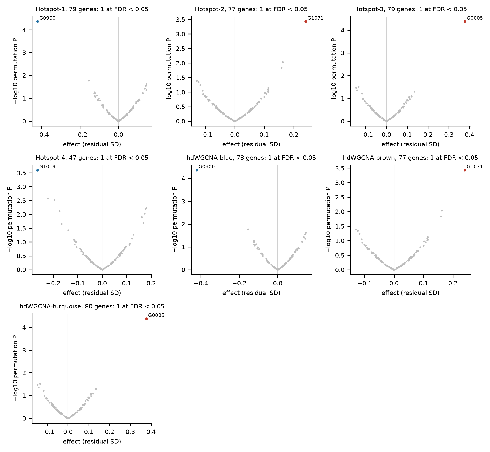
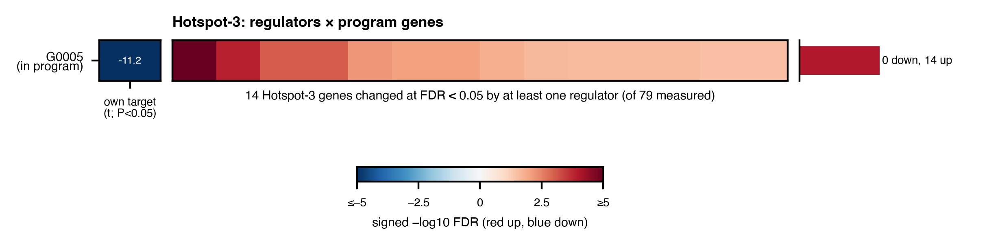

# Quick start

Try CRISProg on a small simulated screen. It takes about 5 minutes on a laptop.

```bash
python example/make_example.py               # make the test screen
python crisprog.py run example/config.yaml   # run everything
```

Results go to `results/example/`.

## The test screen

6,000 cells and 124 knockdowns. The genes are made up, and two knockdowns were given a real effect on purpose:

- **G0005** raises program A;
- **G0900** lowers program B.

Every other knockdown does nothing. A good tool should find those two and nothing else.

## What you'll see

CRISProg finds the gene programs on its own and tests every knockdown against each one. The main plot, one panel
per program:



| Hit | Is it real? | How you can tell |
|---|---|---|
| G0005 → program A | :material-check-circle:{ style="color:#12b76a" } yes, planted | it changes 14 of the program's genes, all up |
| G0900 → program B | :material-check-circle:{ style="color:#12b76a" } yes, planted | it changes 9 of the program's genes, all down |
| G1071 | :material-close-circle:{ style="color:#f04438" } no, chance | it changes no gene on its own |
| G1019 | :material-close-circle:{ style="color:#f04438" } no, its own knockdown | flagged `self-driven?` |

So the two planted effects are found, and the two chance hits are easy to spot from the gene-by-gene check.

??? note "See the gene-by-gene check"
    Each row is a knockdown and each column one of the program's genes; red is up, blue is down. G0005 raises
    14 genes of its program:

    

## Next

- **Your own data:** [Preparing your data](guide/inputs.md).
- **A real screen, start to finish:** the [cardiomyocyte example](vignettes/cardiomyocytes.md).
