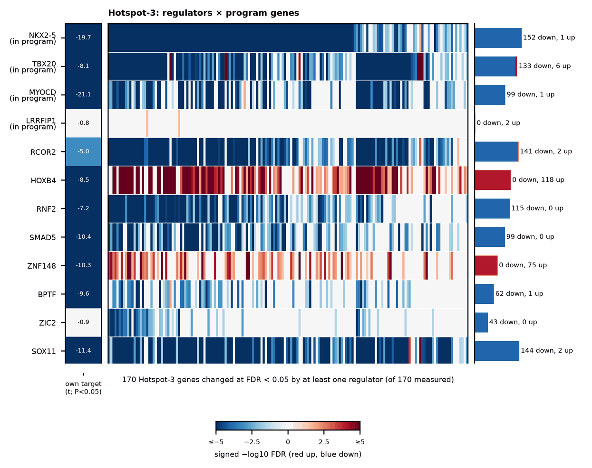
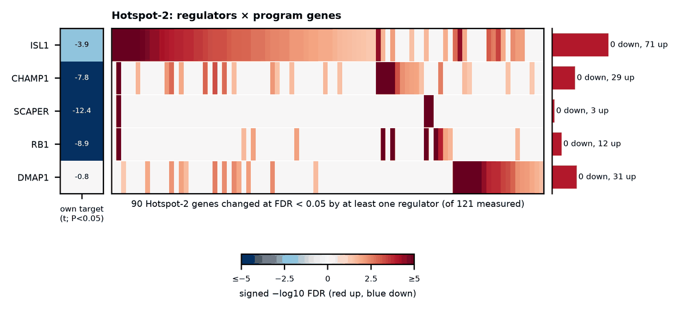

# TF Perturb-seq in cardiomyocytes

A public screen, start to finish: download the data, run CRISProg, and explore what it finds. No program file is
given here, so the programs are discovered from the screen itself. Each guide targets one transcription factor's
promoter, so every unit is simply a gene.

<div class="cp-stats">
  <div class="cp-stat"><div class="v">737,263</div><div class="l">cardiomyocytes (iPSC-derived, day 12)</div></div>
  <div class="cp-stat"><div class="v">1,905</div><div class="l">TFs tested, ~6 guides each</div></div>
  <div class="cp-stat"><div class="v">17</div><div class="l">programs found in the screen</div></div>
  <div class="cp-stat"><div class="v">1,888</div><div class="l">hits at FDR &lt; 0.05 (1,336 beyond controls)</div></div>
</div>

<nav class="cp-steps" aria-label="Steps">
  <a href="#get-the-data"><span>1</span>Data</a>
  <a href="#build-the-inputs"><span>2</span>Inputs</a>
  <a href="#configure"><span>3</span>Config</a>
  <a href="#run"><span>4</span>Run</a>
  <a href="#check-the-data"><span>5</span>Check</a>
  <a href="#programs"><span>6</span>Programs</a>
  <a href="#negative-controls"><span>7</span>Controls</a>
  <a href="#results"><span>8</span>Results</a>
  <a href="#regulators"><span>9</span>Regulators</a>
  <a href="#per-gene-follow-up"><span>10</span>Follow-up</a>
  <a href="#report"><span>11</span>Report</a>
</nav>

!!! info "The data"
    IGVF analysis set [IGVFDS6332VCTO](https://data.igvf.org/analysis-sets/IGVFDS6332VCTO/) (Hon lab): CRISPRi
    Perturb-seq in WTC-11 iPSC-derived cardiomyocytes, 28 10x libraries. The library targets ~2,000 TF promoters,
    plus non-targeting guides, guides against olfactory-receptor promoters (silent in cardiomyocytes, so
    "safe-targeting" controls) and a few positive-control genes.

<div id="cm-app" data-src="../data/cm.json"></div>

## 1. Get the data { #get-the-data }

<p class="cp-lede">Three files from the IGVF portal, about 76 GB in total.</p>

```bash
bash download.sh        # into raw/; re-running resumes and checks md5 sums
```

[:material-download: download.sh](files/cardiomyocytes/download.sh){ .md-button }

| File | What it holds |
|---|---|
| `IGVFFI3617IJOW.h5` | cells × genes UMI counts (Cell Ranger) |
| `IGVFFI4735RXPI.pkl` | guides × cells UMI counts; guide calls already thresholded |
| `IGVFFI8270UPKB.csv.gz` | the guide library: guide ID, spacer, type, target |

!!! warning "Check before you load"
    Loading a pickle runs code from the file. `download.sh` compares md5 sums with the portal; only load the file
    after that check passes.

## 2. Build the inputs { #build-the-inputs }

<p class="cp-lede">One script turns the portal files into the two inputs CRISProg needs.</p>

```bash
python prep_cm.py --raw raw --out data      # needs a high-memory node: the pickle is 71 GB
```

[:material-download: prep_cm.py](files/cardiomyocytes/prep_cm.py){ .md-button }

=== "data/tf_cm.h5ad"

    737,263 cells × 14,946 genes.

    - `.X`: log-normalized expression; `layers['counts']`: raw UMI.
    - `.obs['guides']`: every guide called in the cell, `;`-separated.
    - `.obs['lane']`: the 10x library, used as batch.

    Cells are kept if they are HTO singlets, have under 20% mitochondrial UMI and carry at least one guide.

=== "data/guide_targets.tsv"

    One row per guide: guide → TF. Library names look like `ADNP2_-_77867536.23-P1P2-1`; the script takes the gene
    (`ADNP2`). All ~6 guides of a TF are tested together as one unit.

=== "Control guides"

    Renamed `NC_<guide id>`, so one pattern marks them all:

    - `NC_non-targeting…`: guides that bind nowhere;
    - `NC_OR…`: guides against olfactory-receptor promoters.

## 3. Configure { #configure }

<p class="cp-lede">Only the lines below differ from the defaults. Click a <b>+</b> to see why each is there.</p>

[:material-download: config.yaml](files/cardiomyocytes/config.yaml){ .md-button }

```yaml
data:
  h5ad: data/tf_cm.h5ad
  counts_layer: counts # (1)!
  guide_col: guides
  control_pattern: '^NC_' # (2)!
  control_types: # (3)!
    non-targeting: '^NC_non-targeting'
    safe-targeting: '^NC_(?!non-targeting)'
  positive_controls: [AARS, B2M, CD151, CD29, ITGB1, CD55, CD81, DNAJC19, MALAT1, NGFRAP1, BEX3, POLR1D, TFRC] # (4)!
  target_map: data/guide_targets.tsv

programs:
  discover:
    methods: [hotspot, hdwgcna] # (5)!
    max_cells: 20000
    hdwgcna:
      group_col: lane # (6)!

covariates:
  use: [log_n_genes, moi]
  batch: [lane] # (7)!
```

1.  Raw counts are used for the data check and for counting genes detected per cell.
2.  Every guide whose name matches is a control: it is never tested as a regulator, and it feeds the negative-control
    check.
3.  Each control type gets its own fake units, so you can compare guides that bind nowhere with guides that bind a
    silent promoter.
4.  Knockdown controls from the library. They are still tested, but labelled and reported apart from the TFs.
5.  No `programs.file`, so programs are discovered from this screen with both methods.
6.  hdWGCNA builds metacells; this keeps cells from different 10x libraries out of the same metacell.
7.  28 libraries; each gets its own model term.

??? tip "Two defaults that matter for this screen"
    - **Guide count as categories** (`covariates.moi_categorical: auto`): one model term per number of targeting
      guides in a cell.
    - **Control-guide count** (`covariates.control_count: auto`): here control guides share cells with targeting
      guides, so the number of control guides in a cell is added too. [Step 7](#negative-controls) shows why.

## 4. Run { #run }

<p class="cp-lede">One command runs all seven steps.</p>

=== "Command"

    ```bash
    python CRISProg/crisprog.py run config.yaml     # results in results/tf_cm/
    ```

=== "As a SLURM job"

    ```bash
    sbatch --cpus-per-task=8 --mem=500G --time=96:00:00 \
      --wrap "python CRISProg/crisprog.py run config.yaml"
    ```

| Step | What it took here |
|---|---|
| Download | hours, limited by the network |
| Build the inputs | ~1 h on a high-memory node |
| CRISProg, all steps | 8 cores, 500 GB; the association test alone took 107 min |

## 5. Check the data { #check-the-data }

<p class="cp-lede">Before anything is tested, <code>0_check/check_report.md</code> says whether the inputs look right.</p>

| | Check |
|---|---|
| :material-check-circle:{ style="color:#12b76a" } | `.X` normalized; raw counts in `counts` (median 3,052 UMI per cell) |
| :material-information-outline: | targeting guides per cell: median 1, mean 1.74, max 17 |
| :material-check-circle:{ style="color:#12b76a" } | 1,139 control guides (582 non-targeting, 557 safe-targeting) |
| :material-information-outline: | 1,905 of 1,913 units have ≥ 10 perturbed cells (median 590) |
| :material-alert:{ style="color:#f79009" } | 73% of units have a measured target gene |
| :material-check-circle:{ style="color:#12b76a" } | target down (t < −2) in 76% of measured units; median t −3.7 |
| :material-alert:{ style="color:#f79009" } | 3 targets clearly **up** after knockdown (*NPAS3*, *ZFPM1*, *ZIC1*) |
| :material-check-circle:{ style="color:#12b76a" } | positive controls knocked down, e.g. *CD81* t −50.9, *B2M* t −21.9 |

??? note "What the two warnings mean here"
    - **Unmeasured targets.** Many TFs are barely expressed, so they drop out of the expression matrix. Their
      knockdown cannot be checked, but they are still tested.
    - **Targets that go up.** CRISPRi should not raise its target; a few such cases are expected by chance. None of
      the three is a hit.

## 6. Programs { #programs }

<p class="cp-lede">Hotspot found 13 programs and hdWGCNA 4, all from this screen.</p>

The two methods give different kinds of programs:

- **Hotspot**: small, tight modules of 20–170 genes, each with a clear theme (sarcomere, cell cycle, collagen…).
- **hdWGCNA**: puts most genes into two large, loose modules (over 2,000 genes each), plus two small ones. The two
  large modules mirror each other, so read them as broad axes (cardiomyocyte vs non-myocyte) rather than discrete
  programs.

??? note "All 17 programs"
    | Program | Genes | Reading | Top enriched term |
    |---|---|---|---|
    | Hotspot-1 | 115 | ribosomal proteins | Eukaryotic Translation Elongation (q = 6e-167) |
    | Hotspot-2 | 121 | cell cycle | G2-M Checkpoint (q = 2e-57) |
    | Hotspot-3 | 170 | sarcomere: *MYH6*, *TTN*, *TNNT2* | Heart Contraction (q = 4e-25) |
    | Hotspot-4 | 89 | glycolysis / OXPHOS | Oxidative Phosphorylation (q = 8e-49) |
    | Hotspot-5 | 40 | epicardial-like, by markers only | none |
    | Hotspot-6 | 57 | fibroblast collagen | Collagen Chain Trimerization (q = 4e-11) |
    | Hotspot-7 | 20 | actin / keratin | RHO GTPase Effectors (q = 1e-4) |
    | Hotspot-8 | 33 | oxidative maturation, MEF2 | Myogenesis (q = 0.003) |
    | Hotspot-9 | 23 | ion channels, *BMP7* | Regulation of Potassium Ion Transport (q = 0.001) |
    | Hotspot-10 | 63 | BMP / WNT progenitor-like | Pathways in Cancer (q = 4e-4) |
    | Hotspot-11 | 25 | unclear | weak |
    | Hotspot-12 | 42 | smooth-muscle-like | Smooth Muscle Contraction (q = 1e-5) |
    | Hotspot-13 | 54 | ECM, non-myocyte | Epithelial Mesenchymal Transition (q = 2e-13) |
    | hdWGCNA-turquoise | 2,535 | broad cardiomyocyte axis | Respiratory Electron Transport (q = 5e-32) |
    | hdWGCNA-blue | 2,152 | broad non-myocyte axis | Eukaryotic Translation Elongation (q = 3e-66) |
    | hdWGCNA-brown | 86 | like Hotspot-10 | weak |
    | hdWGCNA-yellow | 56 | RNA processing | Myc Targets V1 (q = 1e-6) |

## 7. Negative controls { #negative-controls }

<p class="cp-lede">Before trusting any hit, check that control guides behave like nothing happened.</p>

**First, a surprise.** In this screen, cells with more detected guides look more cardiomyocyte-like, and a
control guide counts as much as a targeting guide. Guide detection depends on cell state, not on what the guide
does. Pick a program to see it:

<div class="cp-widget" id="cm-calib" data-cm></div>

Without a fix, a cell carrying one targeting and one control guide would be compared with cells carrying one
targeting guide, and would look more cardiomyocyte-like for that reason alone. With the control-guide count in the
model, cells are compared at the same number of detected guides of each kind.

**Then the check itself.** CRISProg groups control guides into fake units the size of a real one (~590 cells) and
tests them like real TFs:

<div class="cp-widget" id="cm-controls" data-cm></div>

- **Safe-targeting guides** stay near 5% in every program, with no hits. They bind a silent promoter just as
  targeting guides bind theirs, so they are the matched comparison.
- **Non-targeting guides** sit higher in the cardiomyocyte-axis programs (up to 28%). This most likely reflects a
  small difference between guides that bind DNA and guides that bind nowhere.

To stay on the safe side, every hit is marked `beyond_controls` when its effect is larger than 99% of control-unit
effects: **1,336 of the 1,888 hits** pass.

## 8. Results { #results }

<p class="cp-lede">1,888 TF–program associations at FDR &lt; 0.05, from 505 TFs and 7 positive controls.</p>

Shuffled tests reach p < 0.05 in 4.1–5.3% of cases, so the tests are calibrated. Explore each program's
volcano plot:

<div class="cp-widget" id="cm-volcano" data-cm></div>

The main pattern is one **cardiomyocyte vs non-myocyte axis**. Click a cell to open that TF below:

<div class="cp-widget" id="cm-heat" data-cm></div>

??? tip "How to read the axis"
    - **Cardiac TFs** (*NKX2-5*, *TBX20*, *MYOCD*, *MEF2C*, *ISL1*): knocking them down lowers the sarcomere program
      (Hotspot-3) and raises the ribosomal, fibroblast and ECM programs.
    - ***HOXB4*, *KMT2A* and *HIF1A*** push mostly the other way. *HIF1A* knockdown raises the oxidative-maturation
      program (Hotspot-8, +0.60), consistent with HIF1α holding back the switch to oxidative metabolism.
    - **Caveat:** knockdown happened during differentiation, so part of the axis may be a shift in cell-type
      composition (more fibroblast-like cells), not regulation inside cardiomyocytes.

## 9. Regulators { #regulators }

<p class="cp-lede">Pick any TF to see its effect on every program, its knockdown and its cell count.</p>

<div class="cp-widget" id="cm-reg" data-cm></div>

**Try these:**

- **NKX2-5**: a strong knockdown (t −19.7) that lowers the sarcomere program and changes 152 of its 170 genes.
- **DMAP1**: the largest effect on the cell-cycle program (+1.27 SD), but only 15 cells, one guide and no
  detectable knockdown. With so few cells, a handful of cycling cells can move the whole program. Treat it as
  noise.
- **B2M**: a positive control (a surface protein) that moves the sarcomere program by 0.14 SD. That looks
  non-specific, so real effects of that size on this program deserve caution.

<div class="cp-widget" id="cm-table" data-cm></div>

## 10. Per-gene follow-up { #per-gene-follow-up }

<p class="cp-lede">For every hit, CRISProg tests the TF against each gene on its own, so you can see whether the
whole program moves or just one gene.</p>

Each heatmap row is one regulator and each column one program gene; the bars on the right count the genes that
changed.

=== "Hotspot-3 · sarcomere (top rows)"

    

    - **NKX2-5** lowers 152 of 170 genes; **HOXB4** raises 118. Both effects are spread across the program.
    - **LRRFIP1** is significant but has no detectable knockdown (t −0.8), changes 2 genes and has a small effect
      (+0.10 SD) within the control floor. Treat with caution.

=== "Hotspot-2 · cell cycle"

    

    - **RB1** (12 genes up) and **ISL1** (71 genes up) are plausible.
    - **DMAP1** raises 31 genes, but from 15 cells, so coordinated changes do not rescue it.

## 11. Report { #report }

<p class="cp-lede">The last step writes a report from all of the above and fact-checks it.</p>

Numbers are checked against the run, and references against PubMed and Crossref. The report covers:

- an overview;
- a label and evidence for every program;
- the main regulators, each with literature;
- positive controls, caveats and testable hypotheses.

[Read the report :material-arrow-right:](cardiomyocytes-report.md){ .md-button .md-button--primary }
